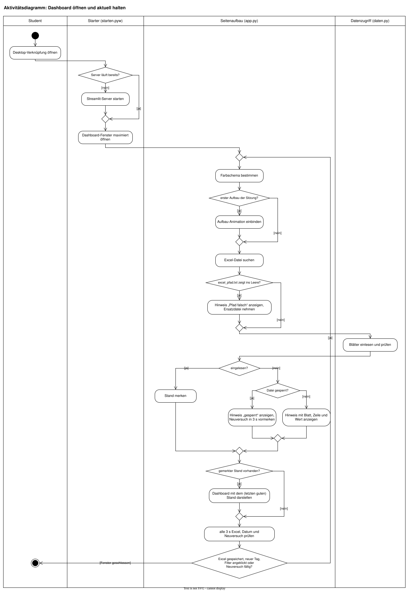

# Uni-Dashboard

[](https://github.com/Lindt01/uniDashboard/actions/workflows/ci.yml)

Wöchentlicher Überblick über mein Semester: Stundenplan, Prüfungstermine und
offene Aufgaben auf einer Seite. Die Daten pflege ich in einer Excel-Datei,
das Dashboard liest sie bei jedem Neuladen ein.


## Funktionen

- Stundenplan als Wochenraster, parallele Termine nebeneinander, der heutige Tag hervorgehoben
- Prüfungen mit Countdown, nicht feststehende Termine gesammelt
- Aufgabenliste mit Filtern zum Anklicken: Wochen, Module und Status (startet auf „Offen“)
- Fristen: offene Aufgaben mit der nächsten Frist stehen oben. Überfälliges ist rot,
  was heute oder morgen fällig ist, pulsiert deutlich, die nächsten 7 Tage nur leicht
- Fortschrittsring je Fach und Säulen je Woche, passen sich den gewählten Filtern an
- Tag- und Nachtmodus mit Glasflächen; beim Öffnen nach Uhrzeit gewählt (19–7 Uhr Nacht), jederzeit umschaltbar
- Aktualisiert sich selbst, sobald die Excel-Datei gespeichert wird
- Verständliche Fehlermeldungen, wenn in der Excel etwas nicht passt (mit Blatt,
  Zeile und Wert). Bis zur Korrektur bleibt der letzte gute Stand sichtbar, eine
  kurz gesperrte Datei wird automatisch erneut gelesen

## Ablauf

Vom Klick auf die Desktop-Verknüpfung bis zum laufenden Dashboard, als
UML-Aktivitätsdiagramm. Streamlit baut die Seite bei jeder Änderung komplett neu
auf, die Aufbau-Animation läuft aber nur beim ersten Mal.



Das Diagramm ist mit [draw.io](https://www.drawio.com) erstellt. Die Datei
[`docs/diagramme/ablauf.drawio.svg`](docs/diagramme/ablauf.drawio.svg) ist Bild
und Quelle zugleich: draw.io (oder die VS-Code-Erweiterung „Draw.io Integration“)
öffnet sie direkt zum Bearbeiten.

## Starten

Voraussetzung: Python 3.12 oder neuer.

```bash
python -m venv .venv
.venv\Scripts\activate          # Windows
# source .venv/bin/activate     # Linux/macOS
pip install -r requirements.txt   # Pakete in genau den getesteten Versionen
pip install -e . --no-deps        # das Projekt selbst (Änderungen wirken sofort)
streamlit run uni_dashboard/app.py
```

Das Dashboard sucht die Excel-Datei in dieser Reihenfolge:

1. den Pfad in `excel_pfad.txt` im Projektordner, z. B. `C:\Users\name\Desktop\UNI.xlsx`
   (so kann die Tabelle liegen, wo man will)
2. `uni.xlsx` im Projektordner
3. `beispiel.xlsx` mit Beispieldaten

### Als Desktop-Programm (Windows)

Nach der Einrichtung oben einmal `windows\verknuepfung_erstellen.bat` ausführen. Auf dem
Desktop liegt dann „Uni-Dashboard“: startet den Server im Hintergrund (ohne
Konsolenfenster) und öffnet das Dashboard als eigenes, maximiertes Fenster.
Fehlermeldungen landen in `dashboard.log`.

Excel sperrt die Datei beim automatischen Speichern in OneDrive. Damit das
Dashboard sie auch bei geöffneter Tabelle lesen kann, in Excel „Automatisches
Speichern“ ausschalten und mit Strg+S speichern.

### Offline

Nach der Installation der Pakete braucht das Dashboard kein Internet. Der Server
lauscht nur auf `localhost` (nicht im WLAN erreichbar), die Schriften liegen in
`uni_dashboard/static/fonts` (Inter und IBM Plex Mono, SIL Open Font License) und Nutzungsstatistiken von
Streamlit sind abgeschaltet.

## Aufbau der Excel-Datei

| Blatt | Spalten |
|---|---|
| `Fächer` | Fächer, Vorlesung, Übung, Prüfung (z. B. `11.02, 9:00` oder `TBA`) |
| `Stundenplan` | Fach, Art, Tag (`Mo`–`Fr`), Von, Bis, Raum |
| `Aufgabenliste` | Modul, Woche, Status (`Done` oder `X`), Notiz; optional Frist: `14.11`, `14.11.2026`, `14.11, 12:00` oder ein Excel-Datum, ohne Uhrzeit gilt 23:59 (`\` oder leer = keine Frist) |

In der Aufgabenliste werden die Spalten über ihre Überschrift gefunden, weitere
Spalten dürfen an beliebiger Stelle stehen.

`uni.xlsx` und `excel_pfad.txt` stehen in `.gitignore` und werden nicht hochgeladen.

## Projektstruktur

```
uni_dashboard/          Das Programm (Python-Paket)
  app.py                Streamlit-Seite: Kopf, Kennzahlen, Stundenplan, Aufgaben
  daten.py              Einlesen und Aufbereiten der Excel-Blätter
  grafiken.py           Diagramme, Fortschrittsringe und Aufgabentabelle
  themen.py             Farben für Tag- und Nachtmodus
  stil.css              Gestaltung (Glasflächen, Karten, Filter)
  aufbau.css            Kurze Aufbau-Animation beim ersten Öffnen
  static/fonts/         Schriften (lokal statt Google Fonts)
windows/                Start als Desktop-Programm unter Windows
  starten.pyw           Server im Hintergrund starten, Fenster öffnen
  verknuepfung_erstellen.bat
tests/                  Tests für daten.py und themen.py
docs/                   Vorschau-GIF, Aktivitätsdiagramm (draw.io), Programmsymbol
.github/workflows/      CI: ruff und pytest bei jedem Push
.streamlit/             Theme, Schrift, Server-Einstellungen
pyproject.toml          Projektdaten, Abhängigkeiten, ruff- und pytest-Einstellungen
beispiel.xlsx           Beispieldaten
```

## Entwicklung

Docstrings folgen dem Google-Stil, Funktionen haben Type Hints. Bei jedem Push
prüft GitHub Actions unter Python 3.12 und 3.13 Stil, Tests und bekannte
Sicherheitslücken in den Paketen, zusätzlich einmal pro Woche. Lokal:

```bash
pip install -r requirements-dev.txt
ruff check .               # Stil und Docstrings
pytest                     # Tests in tests/ und Beispiele in den Docstrings
pip-audit --skip-editable  # bekannte Sicherheitslücken
```

### Paketversionen

`pyproject.toml` nennt nur Mindestversionen. Die genauen Versionen aller Pakete,
mit denen getestet wird, stehen in `requirements.txt` und `requirements-dev.txt`.
[Dependabot](.github/dependabot.yml) prüft jeden Montag auf neuere Versionen
und öffnet dafür Pull Requests, die die CI automatisch testet. Nach einer
Änderung an den Abhängigkeiten in `pyproject.toml` die Lock-Datei neu erzeugen:

```bash
pip install pip-tools
pip-compile --strip-extras --no-emit-index-url --output-file requirements.txt pyproject.toml
```

## Geplant

- [ ] Docker-Image
- [x] Tests für `daten.py`
- [x] GitHub Actions (Lint und Tests)
- [x] Paketversionen festlegen und automatisch auf Sicherheitslücken prüfen (Dependabot, pip-audit)
- [ ] Betrieb im Homelab
- [x] Tag- und Nachtmodus
- [x] Fristen: Spalte „Frist“ auswerten, Fälliges hervorheben, Überfälliges rot
- [ ] Wochenrückblick: erledigte Aufgaben der letzten Woche im Vergleich zur Vorwoche
- [ ] Uni-Mails unten im Dashboard anzeigen (IMAP, nur lesend, Passwort in der Windows-Anmeldeinformationsverwaltung)

## Lizenz

Code unter der [MIT-Lizenz](LICENSE). Die Schriften in `uni_dashboard/static/fonts` stehen
unter der SIL Open Font License (Lizenztexte im selben Ordner).
