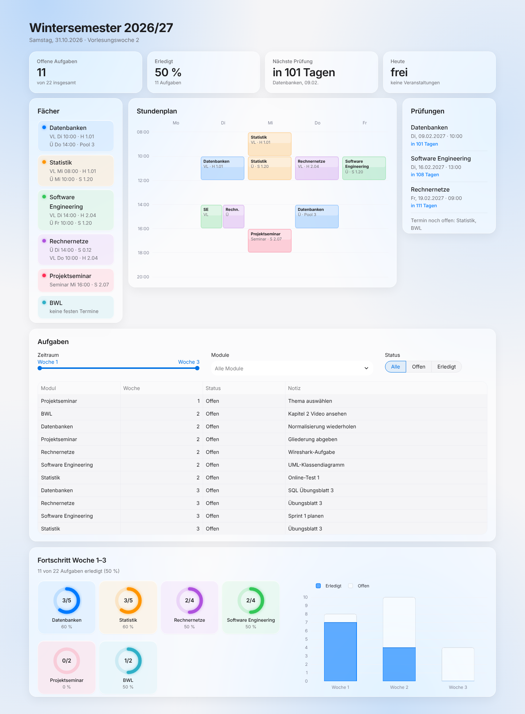

# Uni-Dashboard

[](https://github.com/Lindt01/uniDashboard/actions/workflows/ci.yml)

Wöchentlicher Überblick über mein Semester: Stundenplan, Prüfungstermine und
offene Aufgaben auf einer Seite. Die Daten pflege ich in einer Excel-Datei,
das Dashboard liest sie bei jedem Neuladen ein.



## Funktionen

- Stundenplan als Wochenraster, parallele Termine nebeneinander
- Prüfungen mit Countdown, nicht feststehende Termine gesammelt
- Aufgabenliste mit Filter nach Zeitraum (Vorlesungswochen), Modul und Status
- Fortschrittsring je Fach und Säulen je Woche, passen sich dem gewählten Zeitraum an
- Aktualisiert sich selbst, sobald die Excel-Datei gespeichert wird

## Starten

Voraussetzung: Python 3.10 oder neuer.

```bash
python -m venv .venv
.venv\Scripts\activate          # Windows
# source .venv/bin/activate     # Linux/macOS
pip install -r requirements.txt
streamlit run app.py
```

Ohne eigene `uni.xlsx` startet das Dashboard mit `beispiel.xlsx`.

### Als Desktop-Programm (Windows)

Nach der Einrichtung oben einmal `verknuepfung_erstellen.bat` ausführen. Auf dem
Desktop liegt dann „Uni-Dashboard“: startet den Server im Hintergrund (ohne
Konsolenfenster) und öffnet das Dashboard als eigenes Fenster. Fehlermeldungen
landen in `dashboard.log`.

### Offline

Nach der Installation der Pakete braucht das Dashboard kein Internet. Der Server
lauscht nur auf `localhost` (nicht im WLAN erreichbar), die Schriften liegen in
`static/fonts` (Inter und IBM Plex Mono, SIL Open Font License) und Nutzungsstatistiken von
Streamlit sind abgeschaltet.

## Aufbau der Excel-Datei

| Blatt | Spalten |
|---|---|
| `Fächer` | Fächer, Vorlesung, Übung, Prüfung (z. B. `11.02, 9:00` oder `TBA`) |
| `Stundenplan` | Fach, Art, Tag (`Mo`–`Fr`), Von, Bis, Raum |
| `Aufgabenliste` | Modul, Woche, Status (`Done` oder `X`), Notiz |

Die eigene `uni.xlsx` steht in `.gitignore` und wird nicht hochgeladen.

## Projektstruktur

```
app.py            Oberfläche (Streamlit)
stil.css          Gestaltung (Karten, Kennzahlen, Ringe)
starten.pyw       Start als Desktop-Programm
daten.py          Einlesen und Aufbereiten der Excel-Blätter
pyproject.toml    Projektdaten, ruff- und pytest-Einstellungen
tests/            Tests für daten.py
.github/workflows CI: ruff und pytest bei jedem Push
beispiel.xlsx     Beispieldaten
.streamlit/       Theme, Schrift, Server-Einstellungen
static/fonts/     Schriften (lokal statt Google Fonts)
```

## Entwicklung

Docstrings folgen dem Google-Stil, Funktionen haben Type Hints. Bei jedem Push
prüft GitHub Actions beides automatisch unter Python 3.10 und 3.12. Lokal:

```bash
pip install -r requirements-dev.txt
ruff check .   # Stil und Docstrings
pytest         # Tests in tests/ und Beispiele in den Docstrings
```

## Geplant

- [ ] Docker-Image
- [x] Tests für `daten.py`
- [x] GitHub Actions (Lint und Tests)
- [ ] Paketversionen festlegen und automatisch auf Sicherheitslücken prüfen (Dependabot, pip-audit)
- [ ] Betrieb im Homelab
- [ ] Deadlines: Spalte „Fällig am“ in der Aufgabenliste, Anzeige „Diese Woche fällig“, Überfälliges hervorheben
- [ ] Wochenrückblick: erledigte Aufgaben der letzten Woche im Vergleich zur Vorwoche
- [ ] Uni-Mails unten im Dashboard anzeigen (IMAP, nur lesend, Passwort in der Windows-Anmeldeinformationsverwaltung)

## Lizenz

Code unter der [MIT-Lizenz](LICENSE). Die Schriften in `static/fonts` stehen
unter der SIL Open Font License (Lizenztexte im selben Ordner).
